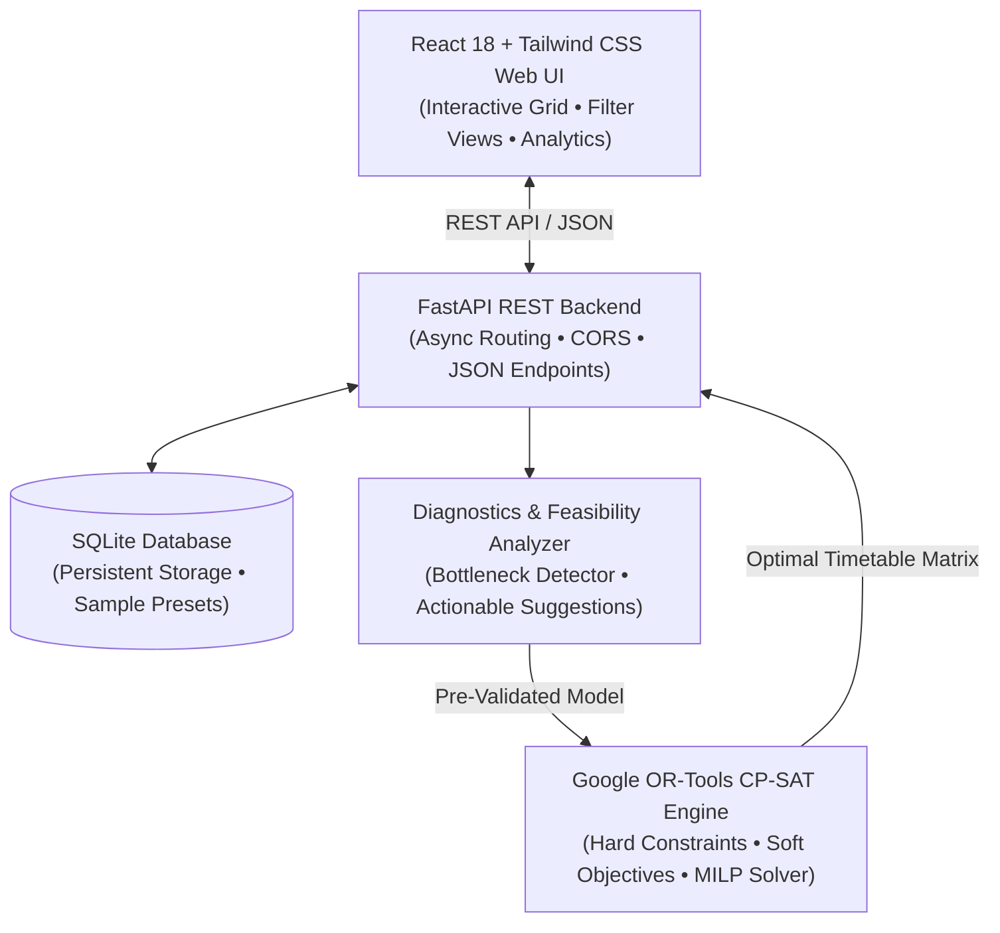

# TimeCraft AI — Intelligent College Timetable Optimization
### 🏆 DevSprint Hackathon Project

> **Automated conflict-free college timetable generation powered by Google OR-Tools CP-SAT, FastAPI, and React with Tailwind CSS.**


---

## 📖 1. Project Overview & Problem Statement

Creating conflict-free academic timetables across multiple departments, student batches, professors, and specialized laboratory rooms is an **NP-Hard combinatorial optimization problem**. Manual scheduling leads to:
- **Faculty double-booking** and room contention.
- **Excessive student idle/gap hours** scattered awkwardly across the day.
- **Unbalanced daily workloads** (e.g., 6 hours on Monday, 1 hour on Tuesday).
- **Suboptimal facility utilization** (costly specialized computer and electronics labs sitting empty while lecture halls are overwhelmed).

**TimeCraft AI** resolves this by modeling academic scheduling as a **Constraint Programming (CP-SAT)** problem using **Google OR-Tools**. It optimizes schedules mathematically in milliseconds, guaranteeing zero hard constraint violations while optimizing student compact hours, daily balance, and faculty preferences.

---

## 🏗️ 2. System Architecture & Tech Stack



### Tech Stack Details:
- **Frontend**: **React 18** with **Tailwind CSS**, dynamic SVG icon library, weekly calendar matrix, and real-time personalized filters (By Student Batch, Faculty, Classroom, or Master View).
- **Backend**: **FastAPI** (Python 3) for clean, high-performance, asynchronous REST APIs with auto-generated OpenAPI documentation.
- **Optimization Engine**: **Google OR-Tools CP-SAT** (`ortools.sat.python.cp_model`), state-of-the-art SAT-based finite domain constraint programming solver.
- **Database / Storage**: **Local SQLite** (`timetable.db`) with automatic schema initialization and 1-click sample data reset.

---

## ⚡ 3. Mathematical Optimization Formulation (CP-SAT)

The scheduling problem is represented as a finite domain constraint satisfaction model:

### Sets & Indices
- $\mathcal{D} = \{0, 1, 2, 3, 4\}$ (Monday to Friday, 5 days)
- $\mathcal{S} = \{0, 1, 2, 3, 4, 5\}$ (6 teaching periods per day; period 4 is followed by lunch)
- $\mathcal{U}$: Set of atomic scheduling units:
  - 1-hour theory lectures ($dur(u) = 1$)
  - 2-hour contiguous lab blocks ($dur(u) = 2$, valid start slots $\in \{0, 2, 4\}$ to respect break boundaries)
- $\mathcal{R}$: Classrooms and laboratories with capacities and room types.
- $\mathcal{F}$: Faculty members with availability and max load constraints.
- $\mathcal{B}$: Student batches/sections with enrolled cohort sizes.

### Decision Variables
$$X_{u, d, s, r} \in \{0, 1\}$$
Indicates whether session unit $u$ starts on day $d \in \mathcal{D}$ at slot $s \in \mathcal{S}$ in room $r \in \mathcal{R}$.

---

### Hard Constraints (Zero-Violation Invariants)

1. **Exact Allocation**: Every unit $u$ must be scheduled exactly once:
   $$\sum_{d \in \mathcal{D}} \sum_{s \in \text{ValidSlots}(dur)} \sum_{r \in \text{CandidateRooms}(u)} X_{u, d, s, r} = 1 \quad \forall u \in \mathcal{U}$$

2. **No Room Overlap**: At any room $r$, day $d$, and time slot $t$:
   $$\sum_{u} \sum_{s \le t < s + dur(u)} X_{u, d, s, r} \le 1 \quad \forall r \in \mathcal{R}, d \in \mathcal{D}, t \in \mathcal{S}$$

3. **No Faculty Double-Booking**: A professor $f$ can teach at most 1 session at time $(d, t)$:
   $$\sum_{u \in \text{TaughtBy}(f)} \sum_{s \le t < s + dur(u)} \sum_{r} X_{u, d, s, r} \le 1 \quad \forall f \in \mathcal{F}, d \in \mathcal{D}, t \in \mathcal{S}$$

4. **No Student Batch Double-Booking**: A cohort $b$ can attend at most 1 session at time $(d, t)$:
   $$\sum_{u \in \text{Enrolled}(b)} \sum_{s \le t < s + dur(u)} \sum_{r} X_{u, d, s, r} \le 1 \quad \forall b \in \mathcal{B}, d \in \mathcal{D}, t \in \mathcal{S}$$

5. **Room Capacity & Type Compatibility**:
   $$\text{CandidateRooms}(u) = \{ r \in \mathcal{R} \mid r.\text{type} = u.\text{room\_type} \land r.\text{capacity} \ge b_u.\text{size} \}$$

6. **Faculty Unavailability Periods**:
   $$X_{u, d, s, r} = 0 \quad \text{if } \exists offset \in [0, dur(u)-1] \text{ s.t. } (d, s + offset) \in f_u.\text{unavailable\_slots}$$

7. **Faculty Daily Maximum Teaching Hours**:
   $$\sum_{u \in \text{TaughtBy}(f)} dur(u) \cdot \sum_{s, r} X_{u, d, s, r} \le f.\text{max\_hours\_per\_day} \quad \forall f \in \mathcal{F}, d \in \mathcal{D}$$

8. **Laboratory Consecutiveness**:
   Lab sessions are allocated contiguous 2-hour slots $(0,1)$, $(2,3)$, or $(4,5)$ in the same room on the same day without crossing breaks.

---

### Soft Constraints & Optimization Objectives

The objective function maximizes timetable quality and satisfaction:
$$\max \left( \sum \text{Rewards} - \sum \text{Penalties} \right)$$

1. **Student Idle Gap Minimization (Weight: $-15$)**:
   Penalizes idle 1-hour windows between classes for student batches:
   $$\text{Gap}_{b, d, t} \ge \text{Active}_{b, d, t} + \text{Active}_{b, d, t+2} - \text{Active}_{b, d, t+1} - 1$$

2. **Daily Workload Balancing (Weight: $+5$)**:
   Encourages smooth distribution of lectures across Monday through Friday (avoiding burnout days).

3. **Morning Preference for Core Subjects (Weight: $+4$)**:
   Soft bonus for scheduling demanding core theory subjects during morning periods ($09:00 - 12:15$).

---

## 🔍 4. Conflict & Infeasibility Diagnostics Engine

When input constraints make a timetable mathematically impossible, the diagnostic analyzer identifies the root cause and presents **actionable suggestions**:

| Conflict Category | Root Cause Detected | Actionable Suggestion Provided |
| :--- | :--- | :--- |
| **`room_capacity`** | Batch size (e.g., 60) exceeds largest lab (capacity 45) | "Increase capacity of Lab-101 or split batch into sections A & B" |
| **`faculty_overload`** | Assigned hours (e.g., 20 hrs) exceed professor's max limit (16 hrs) | "Increase Dr. X's max limit or assign co-faculty to the course" |
| **`unavailability_conflict`** | Professor required for 16 hrs, but 18 of 30 slots marked unavailable | "Remove some preferred unavailable slots for Dr. X" |
| **`batch_overload`** | Weekly required hours (e.g., 34 hrs) exceed total available slots (30) | "Reduce course weekly frequency or add Saturday periods" |
| **`room_shortage`** | Total required computer lab hours exceed total capacity of existing lab rooms | "Add an additional computer lab or adjust lab duration" |

---

## 🚀 5. Quickstart & How to Run Locally

### Prerequisites
- Python 3.10+ (tested on Python 3.13)
- Modern web browser (Chrome, Edge, Firefox, Safari)

### Step 1: Clone & Navigate to Project Directory
```bash
cd /Users/apple/.gemini/antigravity/scratch/timetable-optimizer
```

### Step 2: Install Python Dependencies
```bash
python3 -m pip install -r requirements.txt
```
*(Dependencies: `fastapi`, `uvicorn`, `ortools`, `pydantic`)*

### Step 3: Launch the Application
```bash
python3 run.py
```

Output:
```
======================================================================
  Intelligent College Timetable Optimization System
  Powered by Google OR-Tools CP-SAT & FastAPI
======================================================================
  • Web Application : http://127.0.0.1:8000
  • API Swagger Docs: http://127.0.0.1:8000/docs
  • API Status      : http://127.0.0.1:8000/api/status
======================================================================
```

### Step 4: Open in Your Browser
Open [http://localhost:8000](http://localhost:8000) to access the complete application!

> 💡 **One-Click Demo**: The system includes a realistic Computer Science department dataset preloaded (Faculty, Labs, Batches, Courses). Click **"⚡ Generate Timetable"** to immediately optimize and view the conflict-free schedule in ~1 second!

---

## 🧪 6. Running Tests

The test suite validates constraint satisfaction invariants, room overlap absence, faculty double-booking prevention, and API integrity:

```bash
python3 -m unittest discover tests -v
```

Output:
```
test_solve_sample_data (test_optimizer.TestTimetableOptimizer) ... ok
test_diagnostics_on_impossible_batch_size (test_optimizer.TestTimetableOptimizer) ... ok
test_status (test_api.TestAPIEndpoints) ... ok
test_get_data (test_api.TestAPIEndpoints) ... ok
test_diagnostics (test_api.TestAPIEndpoints) ... ok
test_optimize_and_retrieve_latest (test_api.TestAPIEndpoints) ... ok
test_csv_export (test_api.TestAPIEndpoints) ... ok

----------------------------------------------------------------------
Ran 7 tests in 2.9s

OK
```

---

## 📁 7. Project File Structure

```
timetable-optimizer/
├── backend/
│   ├── app/
│   │   ├── __init__.py
│   │   ├── main.py              # FastAPI application, CORS, static mounting
│   │   ├── models.py            # Pydantic data schemas & timetable constants
│   │   ├── db.py                # SQLite persistence layer & CRUD helpers
│   │   ├── sample_data.py       # Rich CS department sample dataset
│   │   ├── engine/
│   │   │   ├── __init__.py
│   │   │   ├── optimizer.py     # Google OR-Tools CP-SAT optimization engine
│   │   │   └── diagnostics.py   # Infeasibility detector & conflict analyzer
│   │   └── routers/
│   │       ├── __init__.py
│   │       ├── data.py          # CRUD endpoints for faculty, rooms, batches, courses
│   │       ├── optimize.py      # Timetable generation & diagnostics endpoints
│   │       └── timetable.py     # Retrieval, filtering, and CSV export
├── static/                      # Self-contained React SPA (served directly by FastAPI)
│   ├── index.html               # Host page with Tailwind CSS
│   ├── app.js                   # React 18 Single-Page Application (Grid, Analytics, Modals)
│   └── styles.css               # Print styles and custom scrollbars
├── frontend/                    # Vite + React modular source code
│   ├── package.json
│   ├── vite.config.js
│   ├── tailwind.config.js
│   ├── index.html
│   └── src/
│       ├── App.jsx
│       ├── main.jsx
│       └── services/
│           └── api.js           # Frontend REST API client
├── tests/
│   ├── test_optimizer.py        # Constraint solver & invariant verification tests
│   └── test_api.py              # Full REST API integration tests
├── run.py                       # Single-command server launcher
├── requirements.txt             # Python requirements
└── README.md                    # Project documentation
```

---

## 📡 8. REST API Reference

| Method | Endpoint | Description |
| :--- | :--- | :--- |
| `GET` | `/api/status` | Service health & solver status |
| `GET` | `/api/data` | Returns all faculty, classrooms, batches, and courses |
| `POST` | `/api/reset-sample` | Resets SQLite database to the demo college dataset |
| `POST` | `/api/optimize` | Executes the Google OR-Tools CP-SAT optimization engine |
| `GET` | `/api/diagnostics` | Pre-validates current inputs for bottlenecks and conflicts |
| `GET` | `/api/timetable/latest` | Retrieves the most recently generated schedule |
| `GET` | `/api/timetable/export/csv` | Downloads the generated timetable as a CSV file |
| `POST` | `/api/faculty` | Creates or updates a faculty profile |
| `DELETE` | `/api/faculty/{id}` | Deletes a faculty member |
| `POST` | `/api/classrooms` | Creates or updates a classroom / lab |
| `DELETE` | `/api/classrooms/{id}` | Deletes a classroom |
| `POST` | `/api/batches` | Creates or updates a student batch |
| `DELETE` | `/api/batches/{id}` | Deletes a student batch |
| `POST` | `/api/courses` | Creates or updates a course curriculum |
| `DELETE` | `/api/courses/{id}` | Deletes a course |

Interactive Swagger documentation is available at **`/docs`** when the server is running.

---

## 👥 Contributors & Acknowledgements

Created for the **DevSprint Hackathon**.
- Optimization Engine: **Google OR-Tools** (Operations Research team)
- Web Framework: **FastAPI** & **Starlette**
- User Interface: **React 18** & **Tailwind CSS**
# GDG-First-Project
